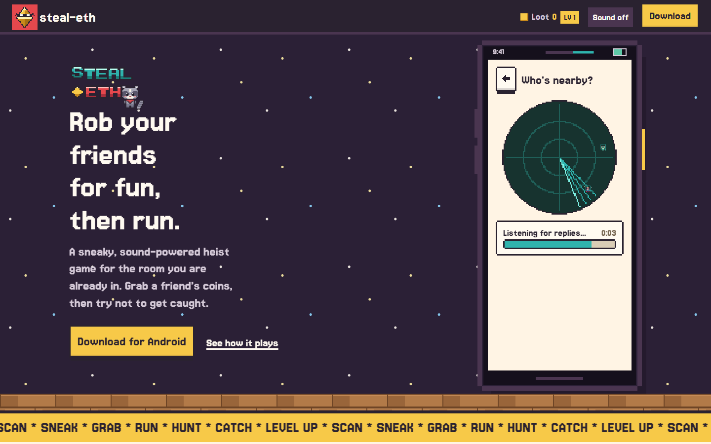
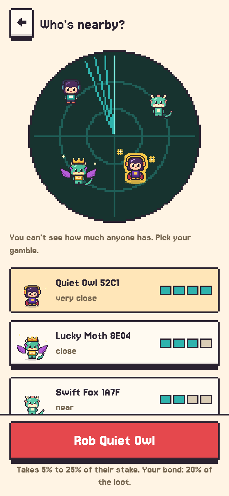
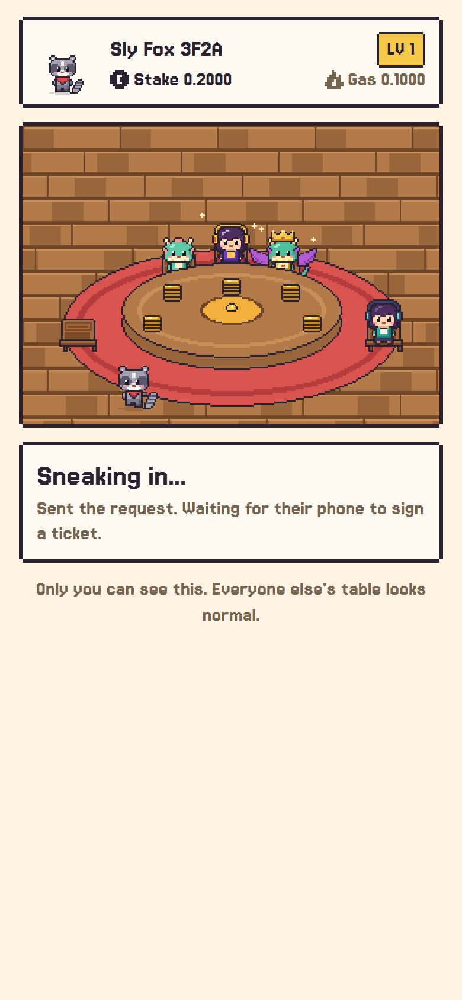
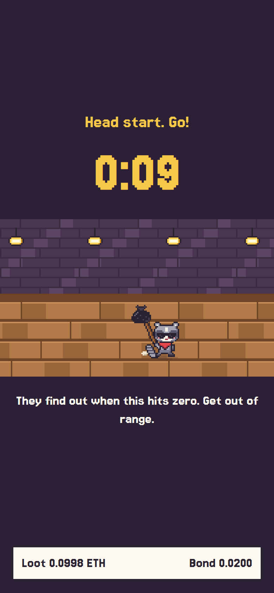
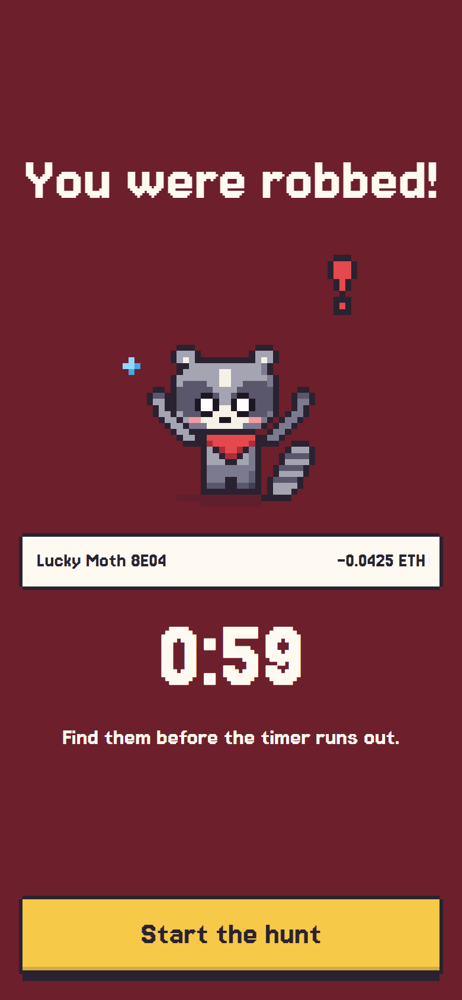
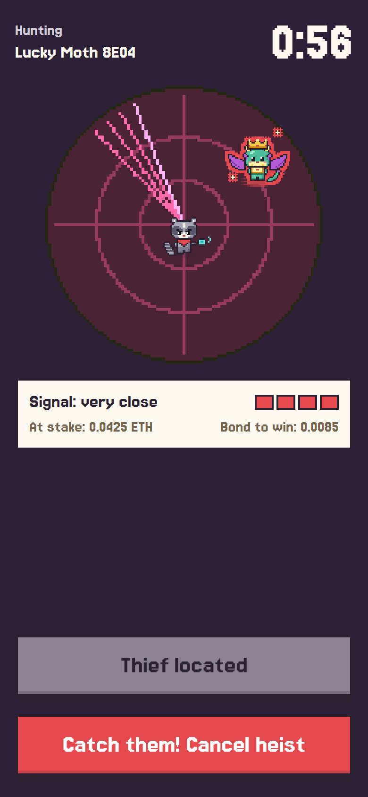
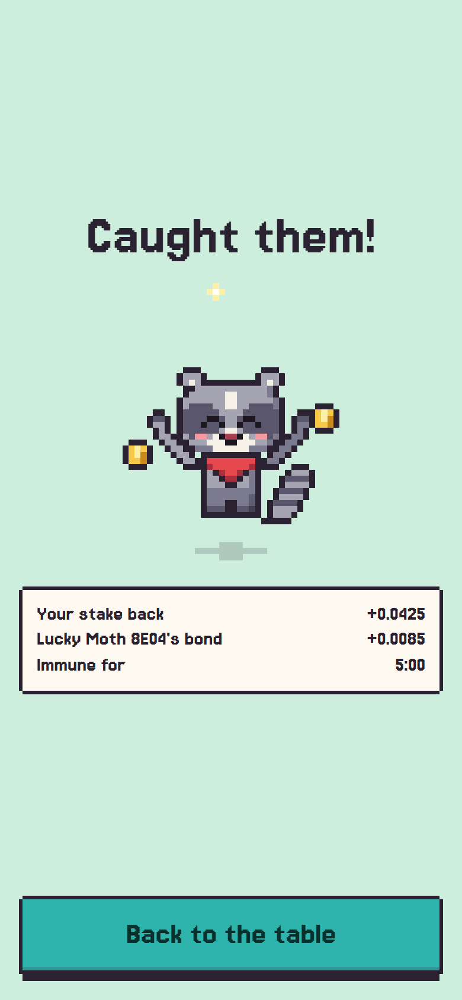

<div align="center">

# steal-eth

### Rob your friends for fun, then run.

**A real-world thief game played over ultrasound.** Walk up to someone, ping their phone with a sound they can't hear, and grab a slice of their stake. Then get out of earshot before they find you.

[**Download for Android**](apps/site/public/steal-eth.apk) &nbsp;·&nbsp; [Website](https://steal-eth.xyz) &nbsp;·&nbsp; [Game rules](#2-game-rules) &nbsp;·&nbsp; [Design spec](#table-of-contents)



</div>

> Working title: "Sonic Heist" and the contract name `HeistVault` are older names for the same project.

---

## See it in the game

| Scan | Sneak | Run |
|:---:|:---:|:---:|
|  |  |  |
| Ping the room and see who is close. You can't see anyone's stake. | Pick a victim and grab the loot. | You get a 10 s head start. Get away. |

| Robbed | Hunt | Saved |
|:---:|:---:|:---:|
|  |  |  |
| The victim's phone buzzes. 60 s on the clock. | Follow the signal until the thief shows up red. | Catch them and get the loot plus their bond back. |

## How it works

1. **Ping.** Phones in patrol mode listen for ultrasound (above ~18 kHz). The thief's ping makes nearby phones answer.
2. **Loot.** The victim's phone auto-signs a one-time consent ticket. The contract moves 5% to 25% of their vault into escrow.
3. **Run.** The thief has 10 seconds before the victim is told.
4. **Hunt.** The victim has 60 seconds to get within ultrasound range and cancel. Cancel returns the loot plus the thief's bond. Miss the window and the thief keeps the loot.

## What's in this repo

| Path | What |
|---|---|
| `app/` | The Android app (Expo / React Native) with the native ultrasound module (`ggwave` over JNI) |
| `apps/web/` | Browser build of the game UI, used to develop and demo the screens |
| `apps/site/` | The [steal-eth.xyz](https://steal-eth.xyz) download site (Vite) |
| `contracts/` | `HeistVault` Solidity contract (Foundry) |
| `backend/` | Small Express + Postgres service for accounts and wallets |
| `docs/` | Protocol test vectors, asset and screen lists |

- Platform: Android, sideloaded APK
- Chain: EVM L2 testnet (default Base Sepolia), test ETH only
- The rest of this document is the design spec the game was built from.

---

## Table of contents

1. [Concept](#1-concept)
2. [Game rules](#2-game-rules)
3. [Core ideas and key design choices](#3-core-ideas-and-key-design-choices)
4. [Player flow, step by step](#4-player-flow-step-by-step)
5. [System architecture](#5-system-architecture)
6. [Tech stack](#6-tech-stack)
7. [Smart contract specification](#7-smart-contract-specification)
8. [Ultrasound protocol specification](#8-ultrasound-protocol-specification)
9. [Mobile app specification](#9-mobile-app-specification)
10. [Android specifics: always-on microphone](#10-android-specifics-always-on-microphone)
11. [Proximity and amplitude](#11-proximity-and-amplitude)
12. [Timing budget](#12-timing-budget)
13. [Security and threat model](#13-security-and-threat-model)
14. [Known limitations](#14-known-limitations)
15. [Safety, privacy and legal](#15-safety-privacy-and-legal)
16. [Repository layout](#16-repository-layout)
17. [Setup, build and run](#17-setup-build-and-run)
18. [Testing plan](#18-testing-plan)
19. [Build plan and milestones](#19-build-plan-and-milestones)
20. [Demo script](#20-demo-script)
21. [Out of scope and future work](#21-out-of-scope-and-future-work)
22. [FAQ](#22-faq)
23. [Glossary](#23-glossary)

---

## 1. Concept

Most blockchain games happen on a screen. Sonic Heist happens in the room.

Each player installs the app, creates a wallet, and deposits test ETH into a **vault** held by a game contract. Phones in "patrol" mode continuously listen for **ultrasound** (sound above roughly 18 kHz that most adults cannot hear). When one player wants to steal from another, their phone broadcasts an ultrasound ping. Phones within a few meters answer. The thief picks a victim from the list, and the victim's phone automatically signs a consent **ticket** that lets the thief start a **loot** on-chain. The thief then runs. Ten seconds later the victim's phone buzzes: *you have been robbed*. The victim has sixty seconds to physically get within ultrasound range of the thief and hit **Cancel**. If they manage, the stolen ETH returns to them and the thief forfeits a bond. If they don't, the ETH goes to the thief.

Sound does two jobs here:

1. **Discovery:** who is near me right now?
2. **Proof of presence:** a signed message exchanged over a few meters of air is evidence that two phones were physically close. The contract treats this as the gate for both starting and cancelling a heist.

Everything else (balances, rules, timers, payouts) lives on-chain, so no server is needed.

### Relationship to SonicPay

This project reuses the "signed message carried over sound" idea from the earlier SonicPay design (offline payments by audio). The difference: SonicPay used sound to carry a payment to a relayer, while Sonic Heist uses sound to prove two phones are close to each other. The game is **not** an offline game: both players need a data connection to submit transactions and to see events. Sound is the proximity oracle, not the network.

---

## 2. Game rules

### Roles

| Role | Description |
|---|---|
| **Player** | Anyone with the app, a wallet and a vault. Every player is simultaneously a potential thief and a potential victim. |
| **Thief** | The player who starts a loot against someone. |
| **Victim** | The player being looted. |
| **Game master** | The contract owner. Can only switch the game on or off (see section 7). Cannot touch anyone's funds. |

### Two balances, do not mix them up

| Balance | Where | Purpose | At risk? |
|---|---|---|---|
| **Wallet ETH** | In the player's own address | Pays **gas** for deposits, loots, cancels and claims | No |
| **Vault ETH** | Inside the game contract | The stake that can be looted | **Yes** |

Gas is never taken from the vault. The loot amount is a percentage of the vault, so a player is never emptied and always keeps something.

### Core rules

1. **Vaults.** Players deposit ETH into their vault at any time. While a game is **active**, vault funds are locked and cannot be withdrawn. Withdrawals are possible only when the game is not active and the player has no loot in progress.
2. **Looting needs consent from proximity.** A thief can only start a loot with a valid **ticket** signed by the victim's phone. The victim's phone signs a ticket automatically only after hearing a targeted loot request over ultrasound.
3. **Random amount.** The loot is a random **5% to 25%** of the victim's current vault, computed on-chain, and at least 0.001 ETH. The thief cannot choose it. (Parameters are configurable at deployment.)
4. **Thief bond.** Starting a loot locks a **bond** of 20% of the loot amount from the thief's own vault. A thief with an empty vault cannot loot.
5. **Head start.** After the loot is recorded on-chain, the thief gets **10 seconds** before the victim is notified.
6. **Hunt window.** The victim then has **60 seconds** to find the thief and cancel.
7. **Cancel.** If the victim gets close enough for an ultrasound handshake with the thief and submits the cancel transaction in time, the loot is reversed: the victim gets the loot amount **and** the thief's bond.
8. **Claim.** If the window expires without a cancel, the loot amount moves to the thief and the bond is returned.
9. **Immunity.** After a loot is resolved (either way) the victim is **immune for 5 minutes**.
10. **Thief cooldown.** After a loot is resolved the thief must wait **2 minutes** before starting another.
11. **One at a time.** A player can have at most one active loot as a victim and at most one active loot as a thief.
12. **No self-looting.** Obviously.

### What the thief sees and does not see

The thief sees nearby players by a generated name (for example, "Swift Fox 3F2A") and a closeness indicator based on signal strength. The thief does **not** see how much is in anyone's vault. Picking a victim is a blind gamble.

### Outcome table

| Event | Victim vault | Thief vault |
|---|---|---|
| Loot started | Loot amount moved into escrow | Bond moved into escrow |
| Cancelled in time | Gets loot amount **plus** the thief's bond | Loses the bond |
| Claimed after deadline | Keeps the remainder | Gets loot amount, bond returned |

---

## 3. Core ideas and key design choices

### 3.1 Why a signed ticket from the victim?

A thief cannot take ETH from someone else's wallet, and the contract cannot tell whether two phones are physically close. The ticket solves both problems:

- It is an **EIP-712 signed message** from the victim saying *"this thief address may start one loot against me, once, until this time"*.
- The victim's phone only signs it after hearing a valid targeted request, so the ticket acts as the **proof of proximity**.
- The contract limits the damage of any ticket (percentage cap, immunity, cooldowns, one loot at a time), so a ticket cannot be abused to drain someone.

### 3.2 Why the vault lives in a contract

The vault is an internal balance inside the game contract, not the player's wallet. This lets the contract move funds by its own rules (escrow, claim, cancel) without needing any further signature from the victim after the ticket.

### 3.3 Why an app and not a browser

The game needs the microphone to be always on, including when the screen is off or the app is in the background. Mobile browsers cannot do this. A native Android app can run a **foreground service** of type microphone (section 10).

### 3.4 Why no backend

| Job | How it is done without a server |
|---|---|
| Nearby players | Ultrasound replies from phones in range |
| Victim notification | The victim's phone already knows a ticket was signed, then watches the contract for the loot event and schedules a **local notification** for the end of the head start |
| Submitting transactions | Each player submits their own |
| Names | Generated deterministically from the player's uid |
| Game state | Read from the contract and its events through an RPC endpoint |

The only external dependency is a public **RPC endpoint**.

### 3.5 The red highlight is UX, the signature is proof

The hunting victim's phone scans for the thief's uid and highlights it in **red**. Anyone could broadcast that uid, so the red entry is only a hint. The cancel only works if the real thief's phone answers a signed handshake (section 8.4), and the contract verifies the thief's signature.

### 3.6 uid design

- `uid` = the first 4 bytes of `keccak256(address)`
- Computable from any address with no lookup, so no backend or registry is needed
- Used for display, discovery and matching only
- **Never trusted on-chain.** The chain only trusts addresses. If two players ever collide (about 1 in 4 billion per pair) the app shows an address suffix to disambiguate.

---

## 4. Player flow, step by step

### 4.1 Onboarding (online)

1. Install the APK and grant permissions: microphone, notifications, and battery-optimization exemption.
2. The app generates a wallet; the private key is stored in the Android Keystore.
3. Fund the wallet with test ETH for gas (from a faucet, or from the organizers' funding script).
4. **Deposit** some ETH into the vault.
5. Run the **ultrasound self-test** (section 9.6).
6. Tap **Start patrol**. A foreground service starts and a persistent notification appears.

### 4.2 Starting a loot (thief)

```
THIEF PHONE                         VICTIM PHONE                         CHAIN
-----------                         ------------                         -----
Tap Scan
PING (broadcast) ------------------>  hears it
                                      waits random slot
                  <---------------- PONG (uid, echo)
(several victims may reply)
Pick one by name + closeness
LOOT_REQ (thief address, victim uid)->
                                      checks policy, auto-signs ticket
                  <---------------- TICKET (signature)
startLoot(ticket) ------------------------------------------------------>  records loot,
                                                                            escrows funds
Run! (10 s head start)                                                      emits LootStarted
```

### 4.3 Being looted (victim)

1. The victim's phone silently signs the ticket and starts watching the contract for a loot event naming this player.
2. When `LootStarted` is seen, the phone stores the thief's address and uid and waits for the **reveal time** (end of the head start).
3. At the reveal time: a **local notification** and vibration, and the hunt screen opens.

### 4.4 The hunt (victim)

1. The app pings every ~3 seconds, **targeted** at the thief's uid.
2. If the thief's phone is in range it answers immediately. The thief shows up in **red** with a closeness meter.
3. The **Cancel transaction** button becomes active while the thief is in range.
4. Tap it: the victim's phone signs a `Catch` message, sends it over ultrasound, and the thief's phone verifies it and auto-signs `Caught`.
5. The victim submits `cancel(...)` to the contract and gets the loot back plus the thief's bond.

### 4.5 Resolution

| Outcome | What happens |
|---|---|
| Victim cancels in time | Loot returns to the victim with the bond, immunity starts |
| Deadline passes | Anyone calls `claim`. The thief receives the loot and gets the bond back |

---

## 5. System architecture

```
+-----------------------------------------------------------------------------+
|                           ANDROID APP (React Native)                        |
|                                                                             |
|  UI screens           Game logic               Chain layer                  |
|  - Onboarding         - Thief state machine    - viem public + wallet client |
|  - Home / vault       - Victim state machine   - Contract ABI + typed data  |
|  - Scan / nearby      - Auto-sign policy       - Event watcher (polling)    |
|  - Loot / run         - Timers / chain clock   - Tx submission              |
|  - Hunt radar                                                               |
|  - Activity log                                                             |
|                                                                             |
|  Protocol layer (TS)            Native audio module (Kotlin + C++/JNI)      |
|  - encode / decode messages     - ggwave encode / decode (ultrasound)       |
|  - EIP-712 signing              - AudioRecord (unprocessed), AudioTrack     |
|  - compact signatures           - Half-duplex scheduler                     |
|                                 - Band-limited level meter (amplitude)      |
|  Storage                        - Foreground microphone service             |
|  - Keystore (private key)                                                   |
|  - Local DB (loots, settings)   Notifications (local only)                  |
+----------------------------------+------------------------------------------+
                                   |  JSON-RPC (HTTPS)
                                   v
                      +--------------------------+
                      |  EVM L2 testnet          |
                      |  HeistVault contract     |
                      +--------------------------+
```

Two key separations:

- **Audio is a dumb pipe.** The native module delivers and sends bytes plus a signal level. All game and crypto logic is in TypeScript so it can be unit-tested without a phone.
- **The contract is the single source of truth.** The app never trusts what it heard; it only uses audio to decide what to sign and when to submit.

---

## 6. Tech stack

| Layer | Choice | Notes |
|---|---|---|
| Mobile framework | React Native (TypeScript) | Bare workflow or Expo prebuild with a dev client. Expo Go cannot load the custom native modules |
| Audio modem | **ggwave** (C++ library) | Ultrasound protocols; multi-frequency FSK with Reed-Solomon error correction; variable payload up to 140 bytes. Wrapped via JNI in a native module (Hermes does not run WebAssembly, so the JS/WASM build is not an option) |
| Audio I/O | Android `AudioRecord` / `AudioTrack` | 48 kHz mono 16-bit; unprocessed source so Android does not filter ultrasound |
| Background | Android foreground service, type `microphone` | Keeps listening with the screen off |
| Ethereum client | **viem** | Typed EIP-712 signing, contract reads, `getLogs`, transactions |
| Key storage | `react-native-keychain` | Backed by the Android Keystore |
| Randomness polyfill | `react-native-get-random-values` | Required for secure key generation in RN |
| Local state | MMKV or SQLite | Active loots, tickets, cached chain clock, settings |
| Notifications | Notifee | Local timed notifications and the foreground service notification. No push server |
| Smart contracts | Solidity 0.8.24+, Foundry, OpenZeppelin | EIP-712 and ECDSA from OpenZeppelin |
| Chain | EVM L2 testnet, ~2 s blocks | Default Base Sepolia (chain ID 84532). Pick an OP-stack network so `blockhash` behaves as expected |
| RPC | Alchemy / Infura / public endpoint | Key embedded in the APK. Use a throwaway free-tier key |
| Distribution | Signed APK, sideloaded | No Google Play review needed |

---

## 7. Smart contract specification

### 7.1 Overview

One contract, `HeistVault`, with no proxy and no upgrade path. It holds all vault ETH and enforces every game rule. The owner can only toggle `gameActive`; the owner has **no ability to move, freeze or redirect player funds**.

### 7.2 Parameters (fixed at deployment)

| Name | Default | Meaning |
|---|---|---|
| `HEAD_START` | 10 s | Time between loot start and victim reveal |
| `HUNT_WINDOW` | 60 s | Time the victim has to cancel after reveal |
| `MIN_LOOT_BPS` | 500 (5%) | Lower bound of the random loot percentage |
| `MAX_LOOT_BPS` | 2500 (25%) | Upper bound |
| `BOND_BPS` | 2000 (20%) | Thief bond as a percentage of the loot amount |
| `MIN_LOOT_AMOUNT` | 0.001 ETH | Smallest loot; lower rolls are raised to this, and a vault below it can't be looted |
| `VICTIM_IMMUNITY` | 300 s | Protection after a loot is resolved |
| `THIEF_COOLDOWN` | 120 s | Wait before the thief can loot again |

Total time from `startLoot` to the claim deadline: `HEAD_START + HUNT_WINDOW` = 70 s.

### 7.3 State

```solidity
mapping(address => uint256) public vault;               // stake balances
mapping(address => mapping(uint64 => bool)) public usedTicket; // victim => nonce
mapping(address => uint256) public activeLootAsVictim;  // lootId or 0
mapping(address => uint256) public activeLootAsThief;   // lootId or 0
mapping(address => uint256) public immuneUntil;
mapping(address => uint256) public thiefReadyAt;
bool public gameActive;
uint256 public lootCount;

enum Status { None, Active, Cancelled, Claimed }
struct Loot {
    address thief;
    address victim;
    uint128 amount;     // escrowed from victim
    uint128 bond;       // escrowed from thief
    uint40  startedAt;
    uint40  revealAt;   // startedAt + HEAD_START
    uint40  deadline;   // revealAt + HUNT_WINDOW
    Status  status;
}
mapping(uint256 => Loot) public loots;
```

### 7.4 EIP-712 types

Domain: `{ name: "SonicHeist", version: "1", chainId, verifyingContract }`

| Type | Signed by | Fields | Used for |
|---|---|---|---|
| `LootTicket` | Victim | `address thief`, `uint64 nonce`, `uint32 validBefore` | Consent to start one loot |
| `Catch` | Victim | `uint256 lootId`, `bytes8 challenge` | Victim asks the thief to confirm presence (verified by the thief's phone only) |
| `Caught` | Thief | `uint256 lootId`, `address victim`, `bytes8 challenge` | Proof that the victim reached the thief (verified on-chain) |

The ticket does **not** contain the victim's address. The contract recovers the victim from the signature. This saves 20 bytes over the air and lets the thief's phone learn the victim's identity from the signature itself.

### 7.5 Functions

```solidity
function deposit() external payable;

function withdraw(uint256 amount) external;
// requires: !gameActive, no active loot as victim or thief

function startLoot(uint64 nonce, uint32 validBefore, bytes calldata sig) external;
// msg.sender is the thief

function cancel(uint256 lootId, bytes8 challenge, bytes calldata thiefSig) external;
// msg.sender must be the victim

function claim(uint256 lootId) external;
// callable by anyone after the deadline

function setGameActive(bool active) external; // owner only
```

### 7.6 `startLoot` logic

1. Require `gameActive`.
2. Require `block.timestamp <= validBefore`.
3. Recover `victim` from `sig` over `LootTicket(msg.sender, nonce, validBefore)`.
4. Require `victim != msg.sender`, `!usedTicket[victim][nonce]`, then mark it used.
5. Require the victim has no active loot and `block.timestamp >= immuneUntil[victim]`.
6. Require the thief has no active loot and `block.timestamp >= thiefReadyAt[msg.sender]`.
7. Compute a pseudo-random `bps` in `[MIN_LOOT_BPS, MAX_LOOT_BPS]` from `blockhash(block.number - 1)`, the victim, the ticket nonce and the loot id.
8. `amount = max(vault[victim] * bps / 10000, MIN_LOOT_AMOUNT)`; require `amount <= vault[victim]`.
9. `bond = amount * BOND_BPS / 10000`; require `vault[msg.sender] >= bond`.
10. Move `amount` out of the victim's vault and `bond` out of the thief's vault into escrow (tracked on the loot record).
11. Record `revealAt = now + HEAD_START`, `deadline = revealAt + HUNT_WINDOW`; set active-loot pointers.
12. Emit `LootStarted`.

### 7.7 `cancel` logic

1. Require `msg.sender == loot.victim`, `status == Active`, `block.timestamp <= loot.deadline`.
2. Recover the signer of `Caught(lootId, victim, challenge)` from `thiefSig`; require it equals `loot.thief`.
3. Set `status = Cancelled`.
4. Credit the victim's vault with `amount + bond`.
5. Clear active pointers; set `immuneUntil[victim]` and `thiefReadyAt[thief]`.
6. Emit `LootCancelled`.

The cancel may be submitted at any time between loot start and deadline, including during the head start if the victim somehow catches the thief.

### 7.8 `claim` logic

1. Require `status == Active` and `block.timestamp > loot.deadline`.
2. Set `status = Claimed`.
3. Credit the thief's vault with `amount + bond`.
4. Clear active pointers; set `immuneUntil[victim]` and `thiefReadyAt[thief]` measured from the deadline.
5. Emit `LootClaimed`.

### 7.9 Events (the app reads these; there is no indexer)

```solidity
event Deposited(address indexed player, uint256 amount);
event Withdrawn(address indexed player, uint256 amount);
event GameStateChanged(bool active);
event LootStarted(
    uint256 indexed lootId,
    address indexed thief,
    address indexed victim,
    uint256 amount,
    uint256 bond,
    uint256 revealAt,
    uint256 deadline
);
event LootCancelled(uint256 indexed lootId, address indexed victim, address indexed thief);
event LootClaimed(uint256 indexed lootId, address indexed thief, address indexed victim, uint256 amount);
```

Because `thief` and `victim` are indexed, each phone queries only its own events cheaply.

### 7.10 Randomness note

The loot percentage uses `blockhash`, which is not secure randomness. A thief could simulate the next block and delay submission to chase a higher percentage. For a testnet hackathon this is acceptable (the ticket expires, and each retry costs gas). For production use commit-reveal or a VRF.

### 7.11 Contract tests (Foundry)

- Happy path: deposit, loot, claim after deadline; balances and events correct
- Happy path: deposit, loot, cancel; victim receives amount and bond
- Loot percentage always within bounds; never exceeds `MAX_LOOT_BPS`
- Ticket replay reverts; ticket for a different thief reverts; expired ticket reverts
- Ticket forged with a wrong key reverts (recovered victim has no balance or wrong identity)
- Self-loot reverts
- Victim immunity and thief cooldown enforced
- One active loot per victim and per thief
- Dust loot reverts
- Thief with insufficient vault for the bond reverts
- Cancel by non-victim reverts; cancel with a signature from a non-thief reverts; cancel after deadline reverts
- Claim before deadline reverts; double claim and cancel-then-claim revert
- Withdraw blocked while the game is active or while a loot is active
- Only the owner can toggle the game; owner cannot move funds
- Fuzz: total ETH in the contract always equals the sum of vaults plus escrow

---

## 8. Ultrasound protocol specification

### 8.1 General rules

- **Transport:** ggwave, ultrasound protocol presets. Use a faster preset for the tiny unsigned messages and the normal preset for signed messages. Final choice comes from field measurement.
- **Maximum payload:** ggwave carries up to 140 bytes in variable-length mode; the largest message here is 81 bytes.
- **Byte order:** big-endian.
- **Header byte:** high nibble is the protocol version (`1`), low nibble is the message type.
- **Signatures:** EIP-2098 compact form, 64 bytes (the app expands to `r, s, v` for the contract).
- **Half-duplex:** a phone cannot reliably listen while playing, so the native module serializes transmit and receive (section 8.5).
- **Unauthenticated by design:** only messages carrying signatures prove anything. Everything else is a hint.

### 8.2 Message summary

| Hex | Name | Direction | Signed? | Bytes |
|---|---|---|---|---|
| `0x11` | `PING` | scanner to everyone nearby, or to one target | No | 11 |
| `0x12` | `PONG` | responder to scanner | No | 7 |
| `0x13` | `LOOT_REQ` | thief to chosen victim | No | 25 |
| `0x14` | `TICKET` | victim to thief | Yes (victim) | 81 |
| `0x15` | `CATCH` | victim to thief | Yes (victim) | 77 |
| `0x16` | `CAUGHT` | thief to victim | Yes (thief) | 77 |

### 8.3 Byte layouts

**PING (11 bytes)**

| Offset | Bytes | Field | Notes |
|---|---|---|---|
| 0 | 1 | header | `0x11` |
| 1 | 4 | `scannerUid` | sender's uid |
| 5 | 2 | `nonce` | random; echoed in the PONG to match replies to this scan |
| 7 | 4 | `targetUid` | `0x00000000` = everyone; otherwise only that player replies |

**PONG (7 bytes)**

| Offset | Bytes | Field | Notes |
|---|---|---|---|
| 0 | 1 | header | `0x12` |
| 1 | 4 | `responderUid` | |
| 5 | 2 | `echoNonce` | copied from the PING |

**LOOT_REQ (25 bytes)**

| Offset | Bytes | Field | Notes |
|---|---|---|---|
| 0 | 1 | header | `0x13` |
| 1 | 20 | `thiefAddress` | full address so the victim can sign a ticket naming it |
| 21 | 4 | `victimUid` | target filter |

**TICKET (81 bytes)**

| Offset | Bytes | Field | Notes |
|---|---|---|---|
| 0 | 1 | header | `0x14` |
| 1 | 4 | `thiefUid` | addressing filter |
| 5 | 8 | `nonce` | random `uint64`, used once |
| 13 | 4 | `validBefore` | `uint32` unix time, about 90 s ahead on the chain clock |
| 17 | 64 | `signature` | over `LootTicket(thief, nonce, validBefore)` |

The thief recovers the victim's address from the signature. Only the intended thief address can use the ticket, so other phones that overhear it gain nothing.

**CATCH (77 bytes)**

| Offset | Bytes | Field | Notes |
|---|---|---|---|
| 0 | 1 | header | `0x15` |
| 1 | 4 | `lootId` | `uint32` is sufficient for this game |
| 5 | 8 | `challenge` | fresh random value |
| 13 | 64 | `signature` | victim over `Catch(lootId, challenge)` |

**CAUGHT (77 bytes)**

| Offset | Bytes | Field | Notes |
|---|---|---|---|
| 0 | 1 | header | `0x16` |
| 1 | 4 | `lootId` | |
| 5 | 8 | `challenge` | echoed from the CATCH |
| 13 | 64 | `signature` | thief over `Caught(lootId, victim, challenge)` |

### 8.4 Sequences

**Discovery**

1. The scanner sends `PING(nonce, target = 0)`.
2. Each phone that is patrolling, not shielded, and hears it picks a **random slot** (default: 6 slots of 1.2 s) and replies with `PONG`, so replies do not collide.
3. The scanner collects `PONG`s for about 8 seconds, de-duplicates by uid, and records a signal level for each.

**Loot request**

1. The thief selects a victim and sends `LOOT_REQ`.
2. If the victim passes the auto-sign policy (section 9.4) it signs a `LootTicket` and replies with `TICKET`.
3. The thief decodes the ticket and submits `startLoot`.

**Hunt and cancel**

1. During the hunt the victim sends `PING(target = thiefUid)` about every 3 seconds. The thief replies with `PONG` immediately (no random slot). This makes each attempt about 2 to 3 seconds regardless of how crowded the room is.
2. When the thief's `PONG` is heard, the thief is shown in red and **Cancel** becomes active.
3. On tap, the victim sends `CATCH(lootId, challenge, sig)`.
4. The thief's phone verifies, auto-signs, and replies with `CAUGHT`.
5. The victim submits `cancel(lootId, challenge, thiefSig)`.

**Thief-side verification of `CATCH` (all must hold, otherwise ignore)**

- `lootId` matches this phone's active loot as thief
- the signature recovers to that loot's victim address
- the loot has not expired (using the chain-synced clock)
- this `(lootId, challenge)` pair has not been answered before
- the request rate is sane (a few per minute at most)

The thief's phone signs `CAUGHT` **automatically**, with no confirmation tap. A device that is not part of the loot cannot trigger a signature, and a stranger who replays or forwards a request is ignored because the signature must recover to the real victim.

### 8.5 Half-duplex and collisions

- The native module has one queue: listen by default, pause listening while transmitting, resume afterward.
- A phone never transmits while it is currently decoding a frame.
- Discovery replies use random slots; targeted replies do not (only one phone answers).
- Scans are rate limited (at most one broadcast `PING` per 5 seconds per phone).
- Each outgoing message is sent once, with an application-level retry (up to 2 times, 8 s timeout) for the signed messages.

---

## 9. Mobile app specification

### 9.1 Screens

| Screen | Purpose |
|---|---|
| **Onboarding** | Create wallet, show address and a QR, request permissions, run the ultrasound self-test |
| **Home** | Wallet balance, vault balance, deposit and withdraw, patrol toggle, immunity timer, game on/off status |
| **Scan** | Broadcast scan, list of nearby players with generated name and closeness bar, tap to loot |
| **Loot (thief)** | Ticket progress, then the run timer: 10 s head start, then the time until the claim is available |
| **Alert (victim)** | Full-screen alert at reveal time with the countdown |
| **Hunt (victim)** | Scan loop, nearby list with the thief highlighted in red, closeness meter, **Cancel transaction** button, countdown |
| **Activity** | Your own recent events (looted, escaped, claimed). A global leaderboard is out of scope for now |
| **Settings** | Shield mode, volume handling, RPC override, developer flags |

### 9.2 Local state and clocks

- **Chain clock.** The app records `chainTime - deviceTime` whenever it reads a block, and uses that offset for ticket validity and deadlines. This avoids trouble from phones with wrong clocks.
- **Authoritative timers.** Once `LootStarted` is seen, `revealAt` and `deadline` come from the event, not from local timers. A local timer started when the ticket was signed is only a fallback.
- **Persistence.** Active loots, pending tickets and the last-seen block are persisted so the app can recover after being killed. If local data is lost, the app rebuilds the current state from `LootStarted` events where the phone's address is the victim or the thief.

### 9.3 State machines

**Thief**

| State | Entry | Exit |
|---|---|---|
| `Idle` | default | user taps Scan |
| `Scanning` | broadcast PING sent | list shown or timeout |
| `Selecting` | PONGs collected | user picks a victim |
| `AwaitingTicket` | LOOT_REQ sent | TICKET received, or timeout (back to Selecting) |
| `Submitting` | ticket decoded, tx sent | tx mined (to Running) or failed |
| `Running` | `LootStarted` seen | deadline passes or loot cancelled |
| `Resolved` | cancelled or claimed | back to Idle |

While in `Running` the thief's phone keeps listening for `CATCH` and answers with `CAUGHT`.

**Victim**

| State | Entry | Exit |
|---|---|---|
| `Idle` | default | a ticket is signed |
| `TicketPending` | ticket signed and sent | loot seen on-chain, or ticket expires (back to Idle) |
| `LootedHidden` | `LootStarted` seen, before `revealAt` | reveal time reached |
| `Hunting` | reveal notification shown | cancelled, or deadline passed |
| `Resolved` | cancelled or claimed | back to Idle |

### 9.4 Auto-sign policy (victim side)

The phone signs a ticket automatically only if **all** of these are true:

1. The patrol service is running and the user has not enabled **shield mode**.
2. The game is active (last known value from the contract).
3. The `LOOT_REQ` targets this phone's uid and contains a well-formed address.
4. This player has no active loot as a victim and no pending, unexpired ticket.
5. The player is not within the immunity window.
6. The last known vault balance is at least a minimum useful amount.
7. At most one ticket has been signed in the last 30 seconds.

If any check fails the phone stays silent. The contract re-checks the hard rules (immunity, one loot at a time, nonce reuse) so the app policy is an optimization and a convenience, not the only protection.

### 9.5 Transactions and gas

- The app uses viem to estimate gas and fees and adds a small buffer, since a missed loot window is costly.
- The thief submits `startLoot` and (if it wants the funds quickly) `claim`; the victim submits `cancel`.
- `claim` is permissionless, so anyone can trigger it for the thief.
- Both players must keep a small gas balance in their wallet. The Home screen warns when it is too low.

### 9.6 Ultrasound self-test

Many phone speakers and microphones are weak above 18 kHz. The onboarding self-test:

1. Plays a short test frame at the configured ultrasound preset.
2. Tries to decode it on the same device.
3. Reports pass or fail and the measured signal level.

A phone that fails should not be used as a demo device. A developer-only setting can switch the preset to audible for debugging, but it is off by default and the game is designed for ultrasound only.

### 9.7 Names

`name = adjective[uid bits] + animal[uid bits] + last 4 hex of uid`, for example "Swift Fox 3F2A". Deterministic, so every phone shows the same name for the same player.

---

## 10. Android specifics: always-on microphone

### 10.1 Required permissions

| Permission | Why |
|---|---|
| `RECORD_AUDIO` | Listen for ultrasound |
| `FOREGROUND_SERVICE` | Run the patrol service |
| `FOREGROUND_SERVICE_MICROPHONE` | Required to declare a microphone foreground service on Android 14 and later |
| `POST_NOTIFICATIONS` | Show the patrol notification and the loot alert (Android 13 and later) |
| `WAKE_LOCK` | Keep the CPU running for decoding with the screen off |
| `REQUEST_IGNORE_BATTERY_OPTIMIZATIONS` | Reduce the chance the OS kills the service (acceptable for a sideloaded APK) |
| `INTERNET` | RPC access |

The service is declared with `android:foregroundServiceType="microphone"`.

### 10.2 Behaviors to plan around

- **Start from the foreground.** On recent Android versions a microphone foreground service cannot be started from the background. The user taps **Start patrol** while the app is open, and the service then keeps running.
- **Persistent notification.** Android requires it and it also shows the user that the microphone is active.
- **Vendor battery managers.** Some manufacturers aggressively kill background services. During setup the app guides players to disable battery restrictions and allow autostart for the app.
- **Audio source.** Use an unprocessed or recognition source and disable echo cancellation, noise suppression and automatic gain, or the system may remove the ultrasound.
- **Volume.** Ultrasound output level depends on the media volume. The app raises media volume while transmitting and restores it afterward, and shows a warning if the volume is very low.

### 10.3 Building and distributing the APK

- Generate a release keystore once (`keytool`) and keep it safe; all APKs distributed to players must be signed with the same key if you ever want updates to install over the old version.
- Build a universal release APK with Gradle.
- Players enable "install unknown apps" for the source they used (file share, link or `adb`).
- Play Protect may warn about an unknown developer; players choose to install anyway.
- Do not put anything secret in the APK. The RPC key is visible to anyone who unpacks it, so use a free, rotatable key.

---

## 11. Proximity and amplitude

The signal level of a received frame is used as a **closeness indicator**, not as a distance measurement.

- The native module measures energy in the ultrasonic band over the captured frame and reports it alongside every decoded message.
- The app smooths the last few readings (exponential moving average) and shows four levels: **far, near, close, very close**.
- Level depends heavily on each phone's speaker and microphone, volume, orientation and obstructions (a pocket, a hand, a bag). Treat it as relative within a session.
- A short per-device calibration (hold two phones together and apart) improves the mapping but is optional.
- The thief's closeness meter during discovery and the victim's meter during the hunt use the same mechanism.

During the hunt the victim gets a free "hot or cold" signal from the replies to the targeted pings: the level rises as they approach the thief.

---

## 12. Timing budget

Rough estimates; **measure on your actual devices**, since ultrasound speed and reliability vary.

| Step | Approx. time | Notes |
|---|---|---|
| Broadcast PING (11 B) | 1 to 2 s | Short message |
| PONG replies with random slots | up to ~8 s | Window is fixed; thief can pick earlier |
| LOOT_REQ (25 B) | 2 to 3 s | |
| TICKET (81 B) | 4 to 7 s | Largest message |
| Submit and mine `startLoot` | 2 to 5 s | ~2 s blocks plus RPC latency |
| **Loot starts on-chain** | roughly 15 to 25 s after Scan | |
| Head start | 10 s | Contract-enforced |
| Hunt window | 60 s | Contract-enforced |
| Targeted ping attempt | 2 to 3 s | About 20 attempts fit in the window |
| CATCH + CAUGHT handshake | 8 to 12 s | Two signed messages |
| Submit and mine `cancel` | 2 to 5 s | **Do this early in the window** |

Because the handshake and the cancel transaction take around 15 seconds in total, the practical hunt window is shorter than 60 seconds. Tell players to cancel as soon as the thief appears in red.

---

## 13. Security and threat model

| Threat | Impact | Mitigation |
|---|---|---|
| Thief forges a ticket | Loot without consent | Ticket must recover to the victim via EIP-712; wrong signer means a different (usually empty) account |
| Ticket replay | Repeated loots | `usedTicket[victim][nonce]` and short `validBefore` |
| Ticket stolen by another player | Loot started by a stranger | Ticket names the thief address; `startLoot` requires `msg.sender` to be that address |
| Mempool front-running of `startLoot` | Someone else submits it | Same reason: only the named thief can use it |
| Victim drained repeatedly | Total loss | Max 25% per loot (or 0.001 ETH if that's more, which can empty a small vault), 5 minute immunity, one loot at a time |
| Thief spams loots | Grief | Bond, cooldown, one active loot |
| Fake red highlight | Victim thinks the thief is near | Highlight is a hint; cancel needs the thief's signature on-chain |
| Replay of a recorded `CATCH` | Thief signs a pointless `CAUGHT` | Verification requires the correct victim, loot and a fresh challenge; only the victim can submit `cancel` |
| Stranger forwards messages | Cancel without presence | Third parties cannot produce the victim's `CATCH` signature or submit the victim's `cancel` |
| Victim and an accomplice relay messages | Cancel without the victim being near | Not prevented (see limitations) |
| Weak on-chain randomness | Thief biases the loot percentage | Accepted on testnet; commit-reveal or VRF for production |
| Owner abuse | Game manipulation | Owner can only toggle `gameActive`; funds cannot be moved or frozen |
| Compromised or rooted phone | Key theft | Key in Keystore; testnet funds only |
| Leaked RPC key in the APK | Quota abuse | Free-tier throwaway key, rotate after the event |
| Microphone eavesdropping concern | Privacy | Only ultrasound frames are decoded; no audio is stored or transmitted (section 15) |

---

## 14. Known limitations

1. **Thief refusal is not handled.** A thief can close the app, enable airplane mode or otherwise refuse to answer the handshake, which makes cancelling impossible. This is a deliberate v1 simplification. Later options are a bond that is only returned with proof of liveness, or a co-signing service.
2. **Accomplice relay.** A victim and a friend near the thief can pass the signed messages along over another channel. The friend must be a participant in that exchange; strangers cannot do it.
3. **Both players need data.** Victims need a connection to see the loot and to submit the cancel; thieves need one to start the loot.
4. **No gasless play.** Each player holds a little ETH for gas.
5. **Ultrasound is hardware dependent.** Some phones cannot send or receive it reliably, and a loud or reflective venue reduces range.
6. **Short range.** A few meters in a quiet environment, less in a crowd.
7. **Background reliability varies by vendor.** Plan a foreground-first demo.
8. **Weak randomness** for the loot percentage (section 7.10).
9. **Clock edge cases.** A cancel submitted right at the deadline can land late because of block time; players should cancel early.

---

## 15. Safety, privacy and legal

- **Testnet only.** Do not use real funds. Real-money games of chance and skill are regulated in many places, including India.
- **Physical safety.** Players walk and run in a real space. Rules for events: no running in traffic, no trespassing, no entering restricted areas, no touching people. Walk-only variants are encouraged for crowded venues.
- **Opt-in.** Everyone who is playing has installed the app and joined. A **shield mode** stops the phone from answering pings and signing tickets, for example in private spaces.
- **Microphone transparency.** The app listens continuously while patrol is on. It only decodes ultrasound frames and discards the audio immediately. Nothing is recorded, stored or uploaded, and there is no analytics or tracking in the app. The persistent notification makes the active microphone visible.
- **Public information.** Player addresses, loot events and vault balances are public on-chain. A name is derived from the address, so it is pseudonymous but not private.

---

## 16. Repository layout

```
sonic-heist/
├── app/                  # Expo / React Native Android app
│   ├── modules/sonic-audio/   # Kotlin + C++/JNI ggwave module, patrol foreground service
│   └── src/              # protocol, chain, game logic, UI screens
├── apps/
│   ├── web/              # browser build of the game UI
│   └── site/             # download site
├── backend/              # Express + Postgres (accounts, wallets)
├── contracts/            # Foundry project (HeistVault.sol)
├── scripts/              # asset generators, simulate-heist.ts, UI tests
└── docs/                 # protocol fixtures, asset and screen lists
```

---

## 17. Setup, build and run

### 17.1 Prerequisites

- Node.js (current LTS) and a package manager
- Java JDK 17 and Android Studio with SDK and **NDK** (needed to compile ggwave)
- Foundry (`forge`, `cast`, `anvil`)
- At least two Android phones with ultrasound-capable speakers and microphones
- A funded deployer wallet on the target testnet and an RPC URL

### 17.2 Deploy the contract

```bash
cd contracts
forge install
forge test
forge script script/Deploy.s.sol --rpc-url $RPC_URL --private-key $DEPLOYER_KEY --broadcast
# note the deployed HeistVault address
cast send $HEIST_ADDRESS "setGameActive(bool)" true --rpc-url $RPC_URL --private-key $DEPLOYER_KEY
```

Keep the game **inactive** while players deposit and test, then activate it when the round starts. Deactivate it at the end so players can withdraw.

### 17.3 Configure the app

Set these in `app/src/config.ts` (or an `.env` file read at build time):

| Key | Example |
|---|---|
| `RPC_URL` | your RPC endpoint |
| `CHAIN_ID` | `84532` (Base Sepolia) |
| `HEIST_ADDRESS` | the address from the deploy step |
| `ULTRASOUND_PRESET_SMALL` | preset for PING, PONG, LOOT_REQ |
| `ULTRASOUND_PRESET_SIGNED` | preset for TICKET, CATCH, CAUGHT |

### 17.4 Build the APK

```bash
cd app
npm install
npx expo run:android                  # debug build on a connected phone

# release
cd android
./gradlew assembleRelease             # output: app/build/outputs/apk/release/
```

Sign the release build with your keystore (configure `signingConfigs` in Gradle) and share the resulting APK with players.

### 17.5 Fund players

```bash
npx ts-node scripts/fund-players.ts addresses.txt 0.005
```

Each player needs gas ETH in the wallet, plus whatever they deposit into the vault.

### 17.6 First run on a phone

1. Install the APK and open the app.
2. Grant microphone and notification permissions; disable battery optimization.
3. Create the wallet and note the address.
4. Run the ultrasound self-test.
5. Deposit into the vault (while the game is inactive or active; deposits are always allowed).
6. Tap **Start patrol**.

---

## 18. Testing plan

### 18.1 Layers

| Layer | What | How |
|---|---|---|
| Contract | All rules in section 7.11 | Foundry unit and fuzz tests |
| Protocol | Encode and decode every message; reject malformed input | Shared JSON fixtures; unit tests in TypeScript |
| Signatures | EIP-712 signing in the app matches what the contract recovers | Cross-check against Foundry-generated vectors |
| End-to-end without audio | Full loot and cancel flow between two keys | `scripts/simulate-heist.ts` on a local `anvil` chain |
| Audio | Decode rate for each message type | Two phones, varying distance and noise |
| Field | Real game with several players | Rehearsal in the demo venue |

### 18.2 Audio test matrix

| Variable | Values |
|---|---|
| Distance | 0.5 m, 1 m, 2 m, 3 m, 5 m |
| Environment | quiet room, background music, crowd noise |
| Phone placement | in hand, in a pocket, in a bag |
| Device pairs | every combination of the phones you will demo with |
| Message type | PING, PONG, LOOT_REQ, TICKET, CATCH, CAUGHT |

Record the success rate for each combination, and the time per message. Use those numbers to set preset choices, retry counts and the practical demo distance.

### 18.3 Acceptance checklist

- [ ] A loot started over ultrasound lands on-chain with the correct amounts
- [ ] The victim's notification fires at the right moment with the app in the background
- [ ] The thief is highlighted in red only when actually in range
- [ ] A cancel completes and returns the loot plus the bond
- [ ] An unanswered loot is claimable after the deadline
- [ ] Immunity, cooldown and one-loot-at-a-time rules hold under real play
- [ ] The app recovers its state after being force-closed during a loot

---

## 19. Build plan and milestones

| # | Milestone | Output |
|---|---|---|
| 1 | Contract and tests | `HeistVault` deployed to the testnet with passing tests |
| 2 | Protocol library | Codecs, typed data, compact signatures, fixtures |
| 3 | No-audio simulation | `simulate-heist.ts` proves the whole flow on-chain |
| 4 | Native audio module | Ultrasound send and receive with level reporting, in a foreground service |
| 5 | Discovery | Scan, PONG slots, nearby list with closeness |
| 6 | Loot flow | LOOT_REQ, TICKET, `startLoot`, thief run screen |
| 7 | Victim flow | Auto-sign policy, event watcher, local notification at reveal |
| 8 | Hunt and cancel | Targeted pings, red highlight, CATCH and CAUGHT, `cancel` |
| 9 | Reliability pass | Persistence, recovery, battery guidance, volume handling |
| 10 | Field test and demo prep | Audio matrix results, APK, rehearsal |

Suggested order of risk: confirm ultrasound works on your demo phones first, then the foreground service behavior, then the chain logic.

---

## 20. Demo script

1. Show the contract on the block explorer and two phones with funded vaults.
2. Phone A (thief) taps **Scan**; phone B (victim) appears by name with a closeness bar.
3. A selects B. A's screen shows **Awaiting ticket**, then **Loot started** with a 10 second run timer.
4. B's phone is in a pocket. After the head start it vibrates and shows **You were robbed** with the 60 second timer.
5. B walks toward A. The thief appears in **red** and the closeness meter climbs.
6. B taps **Cancel transaction**. The handshake completes, the transaction confirms, and B's vault is restored plus A's bond.
7. Repeat once where B does not find A, and show the claim after the deadline.

---

## 21. Out of scope and future work

**Intentionally excluded from this version**

- **Leaderboard and global statistics.** Will be designed separately. Only a per-player activity log is included.
- Handling of thieves who refuse to answer the handshake.
- A gasless relayer.

**Possible later**

- A relayer so players never hold gas ETH
- Rounds, seasons and a prize pot funded by a small fee
- A leaderboard (indexer or subgraph) and spectator view
- Stronger proximity checks (challenge and response with timing, multi-device attestation)
- Liveness proof for thieves, with an on-chain penalty for refusal
- Safe zones and time-of-day rules
- Commit-reveal or VRF randomness
- iOS version (background microphone limits make this harder)
- Push notifications as a backup to local alerts
- Encrypted payloads so nearby listeners learn less from the audio

---

## 22. FAQ

**Why is the victim's phone allowed to sign automatically?**
Because the victim cannot stop to confirm while someone is standing next to them. The contract limits what a ticket can do (percentage cap, immunity, cooldown, one at a time), and shield mode lets players opt out.

**Why not just let the thief take ETH from the victim's wallet?**
That would need the victim's private key. A vault inside a contract lets the contract apply the rules by itself.

**Why does the thief need a bond?**
Without it, a thief can start loots at no cost and cancelling would have no consequence. The bond makes a failed heist cost something and rewards the victim for finding the thief.

**What if the thief has no internet?**
They cannot submit `startLoot`, the ticket expires, and nothing happens.

**What if the victim has no internet?**
They will not see the loot event or be able to submit the cancel. The game assumes both players have data.

**Why not use Bluetooth or GPS for proximity?**
Ultrasound is short range, needs no pairing, works indoors, and every phone already has a speaker and a microphone. It also avoids location tracking.

**Can someone farm another player's phone by broadcasting its uid?**
They can show a fake red entry, but cannot cancel anything or sign anything on the thief's behalf.

**Is the audio stored?**
No. Audio is decoded in memory and discarded.

---

## 23. Glossary

| Term | Meaning |
|---|---|
| **Vault** | A player's ETH balance inside the game contract; the amount that can be looted |
| **Wallet** | The player's own address that pays gas |
| **Loot** | One heist: an amount moved into escrow until it is cancelled or claimed |
| **Ticket** | The victim's signed consent that lets a specific thief start one loot |
| **Bond** | Funds the thief locks when starting a loot; forfeited if the loot is cancelled |
| **Head start** | The 10 seconds before the victim is told |
| **Hunt window** | The 60 seconds the victim has to cancel |
| **Reveal time** | When the head start ends and the victim is notified |
| **Immunity** | The period after a loot when a victim cannot be looted again |
| **uid** | First 4 bytes of `keccak256(address)`; a short player handle |
| **Shield mode** | App setting that stops the phone from answering pings and signing tickets |
| **Patrol** | The foreground service that keeps the microphone listening |
| **ggwave** | Open-source library that sends data as sound |
| **EIP-712** | Standard for signing typed structured data |
| **EIP-2098** | Compact 64-byte signature format |
| **Foreground service** | Android service with a visible notification that may keep running in the background |
